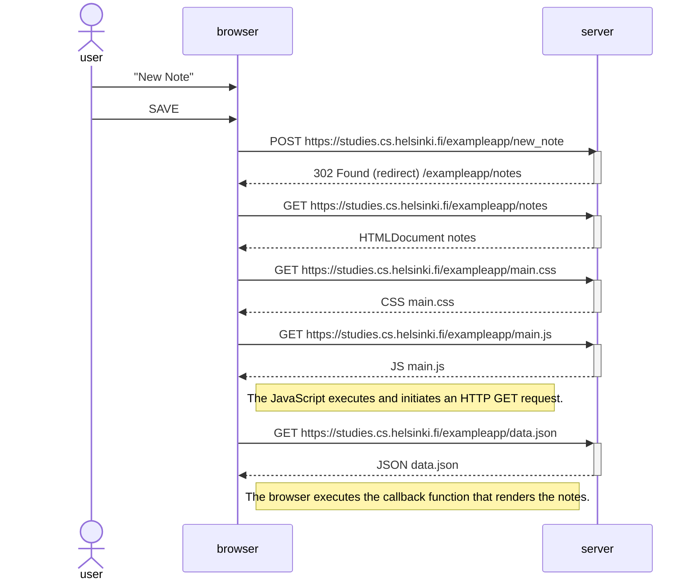

# 0.4: New note diagram

Create a similar diagram depicting the situation where the user creates a new note on the page https://studies.cs.helsinki.fi/exampleapp/notes by writing something into the text field and clicking the Save button.

# Submission

> [!Note]
> I have deliberately used both `activate... deactivate` and the shorthand syntax to demonstrate knowledge of both.
> I will endeavour to use the short hand in all future sequenceDiagram submissions.
